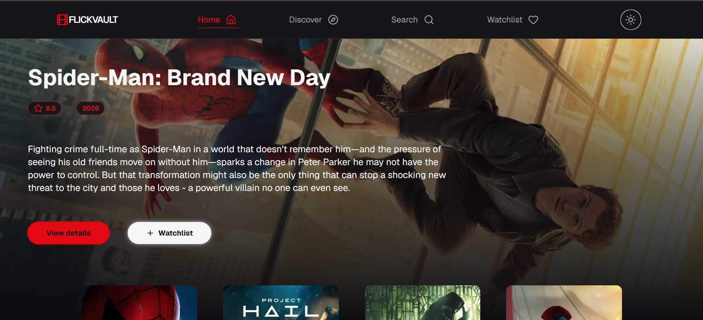
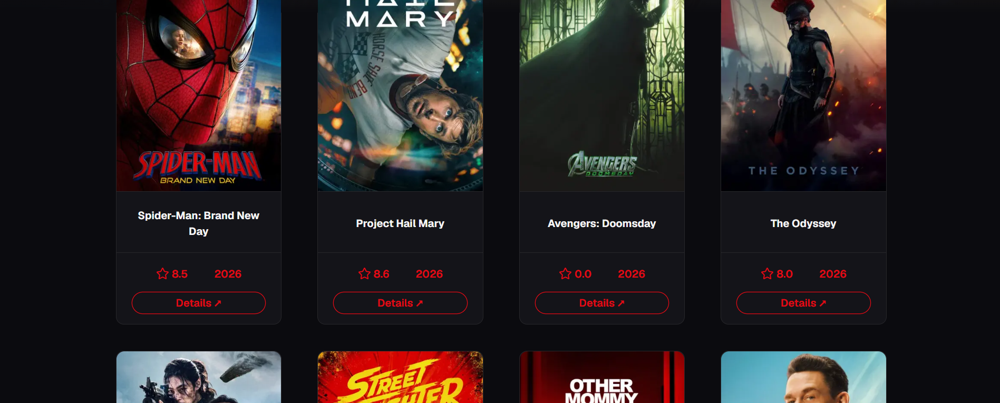
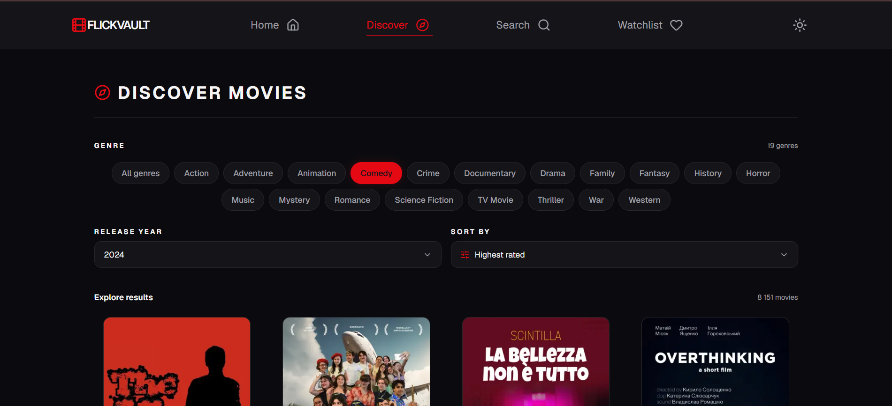
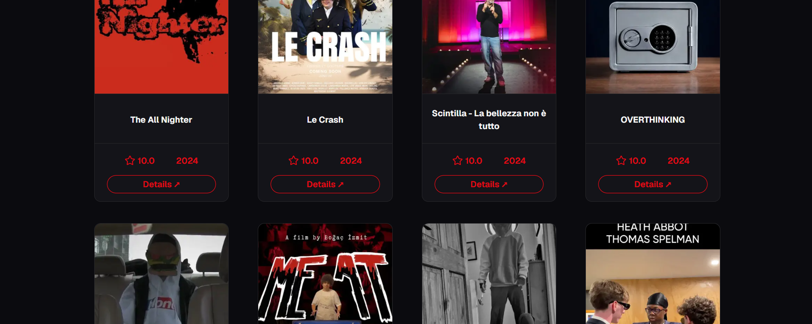
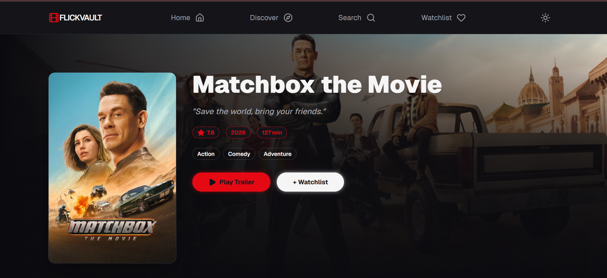
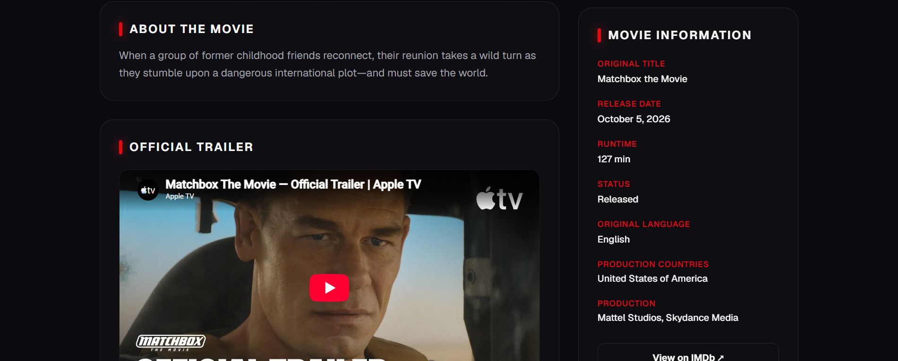
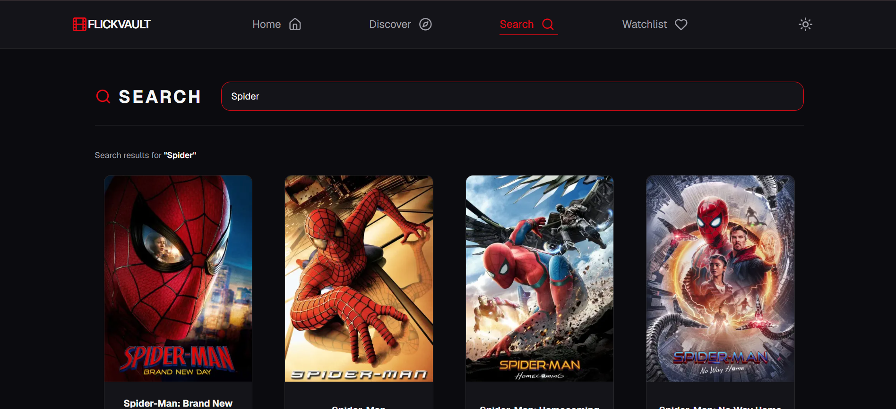
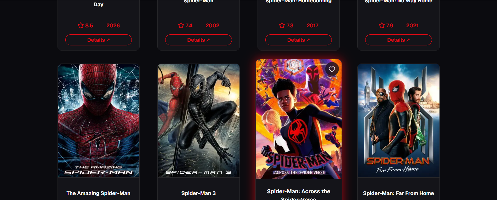
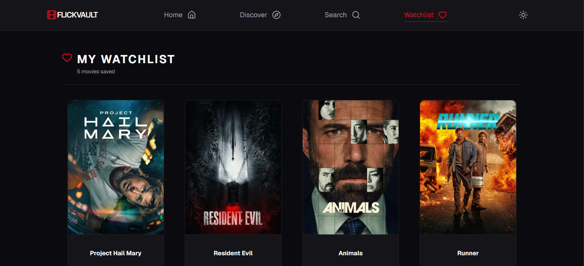
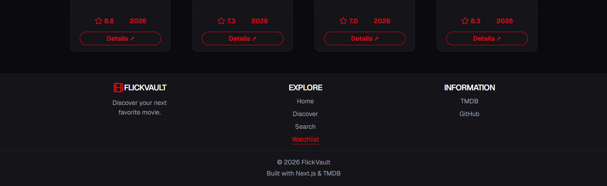

# FlickVault

**Discover your next favorite movie.**

FlickVault is a movie discovery web application powered by the TMDB API. Explore popular movies, discover titles by genre and release year, search for specific films, view detailed movie information, and save your favorites to a personal watchlist.

<p align="center">
  <a href="https://flickvault-chi.vercel.app/"><strong>Live Demo</strong></a>
  &nbsp; · &nbsp;
  <a href="https://github.com/SofiaUmrish/flickvault"><strong>GitHub Repository</strong></a>
</p>

## Screenshots

### Home

Discover popular movies and explore featured titles.




### Discover

Browse the movie catalog and refine results using genre, release year, and sorting options.




### Movie Details

Explore movie information, ratings, genres, release details, and official trailers.




### Search

Find movies by title with a responsive search experience.




### Watchlist

Keep track of movies you want to watch and manage your saved titles.




## Features

- **Movie Discovery** — browse popular movies and explore the catalog.
- **Advanced Filtering** — filter movies by genre and release year, with sorting options.
- **Movie Search** — search for titles using a debounced search input.
- **Movie Details** — view descriptions, ratings, release information, genres, and other movie metadata.
- **Official Trailers** — watch available official trailers directly on the movie details page.
- **Personal Watchlist** — add or remove movies and keep your selections saved in browser storage.
- **Persistent State** — Zustand with persistence middleware keeps the watchlist available after page reloads.
- **Responsive UI** — a movie-focused interface designed for browsing and discovering titles.

## Tech Stack

| Technology | Purpose |
| --- | --- |
| Next.js (App Router) | Application routing, pages, and API routes |
| React | Component-based user interface |
| TypeScript | Type safety and maintainable code |
| Tailwind CSS | Utility-first styling |
| TanStack Query | Server-state management, caching, and data fetching |
| Zustand | Client-state management for the watchlist |
| TMDB API | Movie data, genres, search results, and trailers |
| Lucide React | Interface icons |
| Vercel | Deployment and hosting |

## API Integration

FlickVault uses [The Movie Database (TMDB) API](https://developer.themoviedb.org/docs) to retrieve movie information.

The application includes Next.js API routes for:

- Popular movies
- Movie details
- Movie discovery and filtering
- Movie genres
- Movie search

API requests are handled through server-side routes, keeping the TMDB Read Access Token out of client-side code.

## Getting Started

### Prerequisites

- Node.js
- npm
- A TMDB account and API Read Access Token

### Installation

Clone the repository:

```bash
git clone https://github.com/SofiaUmrish/flickvault.git
cd flickvault
```

Install dependencies:

```bash
npm install
```

### Environment Variables

Create a `.env.local` file in the project root and add your TMDB Read Access Token:

```env
TMDB_API_READ_ACCESS_TOKEN=your_tmdb_read_access_token
```

Replace the placeholder with your own token from your TMDB account.

**Important:** Never commit `.env.local` or expose your API token in client-side code.

### Run Locally

Start the development server:

```bash
npm run dev
```

Open [http://localhost:3000](http://localhost:3000) in your browser.

### Production Build

Check the production build locally:

```bash
npm run lint
npm run build
```

## Deployment

FlickVault is deployed on Vercel.

- **Live application:** [https://flickvault-chi.vercel.app/](https://flickvault-chi.vercel.app/)
- **Repository:** [https://github.com/SofiaUmrish/flickvault](https://github.com/SofiaUmrish/flickvault)

To deploy your own instance, import the repository into Vercel and configure `TMDB_API_READ_ACCESS_TOKEN` in the project's Environment Variables.

## Learning Outcomes

This project provided hands-on experience with:

- Building a multi-page application using the Next.js App Router.
- Integrating an external REST API through server-side API routes.
- Managing asynchronous server state and caching with TanStack Query.
- Managing persistent client state with Zustand.
- Working with TypeScript types for API responses.
- Implementing search, filtering, sorting, and paginated data fetching.
- Preparing and deploying a production build.

## Acknowledgements

Movie data and related metadata are provided by [The Movie Database (TMDB)](https://www.themoviedb.org/).

This product uses the TMDB API but is not endorsed or certified by TMDB.

---

Built as a frontend portfolio project.
